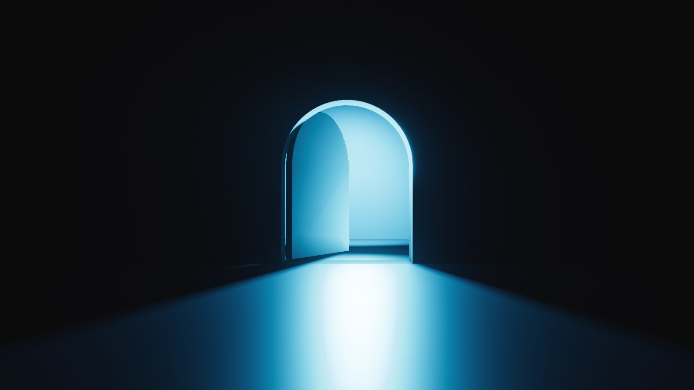
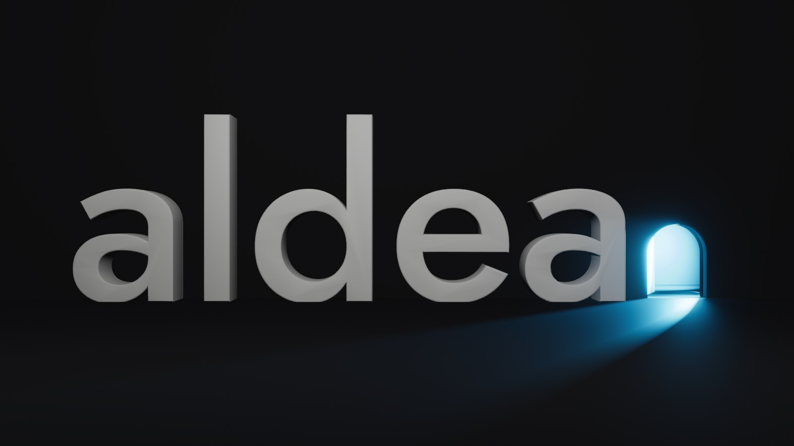

# Aldea Logo Lab 3D

Herramienta de exploración del logo **aldea.** en Three.js: la palabra "aldea" con una puerta en arco como punto final, abierta, con luz físicamente plausible saliendo de adentro.




## Cómo correrlo

```bash
cd aldea-logo-lab-3d
npm install
npm run dev        # http://localhost:5173
```

Build de producción: `npm run build` (sale en `dist/`) y `npm run preview` para probarlo.

## Fuente

El wordmark usa **Jost 500** (OFL) como typeface JSON para `TextGeometry`, ya incluido en `src/assets/jost-500.typeface.json`. Para regenerarlo desde el WOFF de `@fontsource/jost`:

```bash
npm run font       # scripts/convert-font.mjs (opentype.js)
```

## Estructura

| Archivo | Qué hace |
| --- | --- |
| `src/config.js` | **Todos los parámetros** (geometría, luces, niebla, post, cámara, calidad). |
| `src/scene/door.js` | Muro con espesor y vano en arco (Shape con hole extruido), hoja con bisagra, habitación. |
| `src/scene/wordmark.js` | "aldea" en 3D. La puerta ocupa el lugar del glifo "." y mide 0.7 × la altura de x. |
| `src/scene/lights.js` | Lámpara interior (spots con sombra VSM), RectAreaLight de relleno en el vano, rebote. |
| `src/scene/materials.js` | Materiales (piso `MeshPhysicalMaterial`, hoja blanca o acento al 50%). |
| `src/post.js` | pmndrs/postprocessing: volumétrico, god rays, exposición, bloom, ACES/AgX, SMAA. |
| `src/effects/VolumetricLightEffect.js` | Haz en el aire: raymarch que lee el shadow map de la lámpara. |
| `src/camera.js` | Vista frontal de un punto y OrbitControls con límites. |
| `src/ui.js` | Panel lil-gui. |

## Notas de render

- **Luz**: `RectAreaLight` no proyecta sombras en Three, así que la luz que dibuja el charco es una `SpotLight` dentro de la habitación, con sombra VSM de blur alto. El muro recorta el charco con la forma del arco y la hoja proyecta su sombra al abrirse. La lámpara está más lejos que el radio de giro de la hoja y un poco más baja que el dintel, así la hoja siempre queda entre la luz y el vano.
- **La hoja nunca aparece delante del arco**: gira sobre el canto interior y queda siempre detrás del plano interior del muro (verificado de 0° a 110°).
- **Sombras cacheadas**: los shadow maps sólo se recalculan cuando cambia algo (apertura, luz, geometría). Orbitar no los re-renderiza.
- **Niebla**: además de `FogExp2`, un efecto volumétrico propio hace que el haz se vea en el aire, recortado por el muro y la hoja.
- **God rays** (opcional): `GodRaysEffect` con la parte del interior visible a través del vano como fuente.
- **Calidad adaptativa**: si el FPS baja de 40, se reduce el shadow map (1024 → 768 → 512). Si no alcanza, se reducen los pasos del volumétrico y el pixel ratio.
- **Exportar PNG**: 2× la resolución de la ventana, sobre el negro de marca `#0B0B0C`.

Parámetros de URL útiles: `?mode=wordmark`, `?angle=30`, `?noui`, `?fixedquality`.
